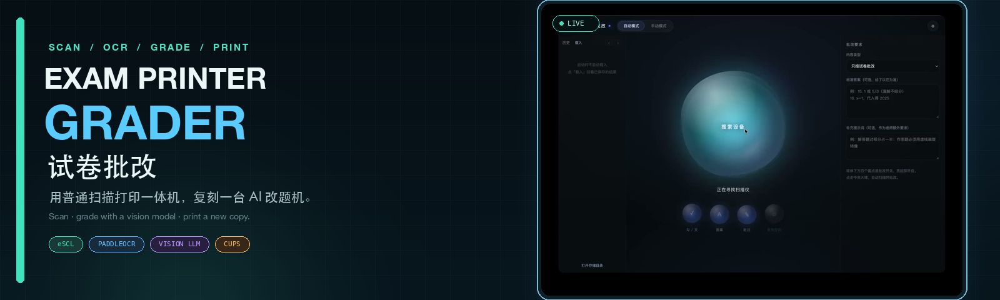

<p align="center">
  
</p>

<p align="center">
  <a href="https://github.com/zhj-ldm/exam-printer-grader/releases/latest"></a>
  
  
  
  
</p>

<p align="center">
  <b>English</b> · <a href="README.md">简体中文</a>
</p>

<p align="center">
  <b>Put a worksheet on the scanner, press one button, and get a newly printed, graded copy.</b><br>
  Turn an ordinary scanner-printer all-in-one into a personal AI exam-grading machine.
</p>

<details>
<summary><b>Contents</b></summary>

- [What It Is](#what-it-is)
- [How It Differs](#how-it-differs)
- [Demo](#demo)
- [Features](#features)
- [How It Works](#how-it-works)
- [Quick Start](#quick-start)
- [Usage](#usage)
- [Configuration](#configuration)
- [Architecture](#architecture)
- [Data & Privacy](#data--privacy)

</details>

## What It Is

A desktop pipeline that connects **scanning, OCR question splitting, vision-model grading, handwritten-mark rendering, and printing**.

Place a completed worksheet face-up on the scanner glass and click the liquid orb. The system automatically:

```text
scan → auto-orient → trim margins → OCR question split
     → grade each question with a vision model
     → place ticks / crosses / half-marks / comments
     → print a freshly graded copy
```

This is not an "upload a photo and let AI comment" tool. **Papers come from the scanner and results come out of the printer**; the workflow is built around the all-in-one device.

> **Important: the printed result is a new copy of the worksheet.**<br>
> It works like copying the original and grading the copy, rather than feeding the original back into the printer. This is intentional: reprinting adapts to different paper, binding and printer hardware far better than trying to mark the original sheet.

## How It Differs

| | Typical AI grading tool | Exam Printer Grader |
| --- | --- | --- |
| Input | Manual photo / upload | Automatic scan from the printer |
| Output | On-screen result / image download | A newly printed paper copy |
| Hardware | Independent of the printer | Scanner and printer are part of the flow |
| Positioning | Image-processing utility | Affordable home grading-machine alternative |

## Demo

▶ **[Watch the full demo](https://github.com/zhj-ldm/exam-printer-grader/releases/download/v1.0.0/exam-grader-demo.mp4)**

> Place the paper on the scanner → click the button → automatic scan and grading → a newly printed graded copy.

## Features

- **One-click pipeline**: a single liquid-orb button runs scan, split, grade and render.
- **Multi-page scanning**: single or multi-page auto mode; scan pages first, grade them together, then review and print page by page.
- **Scannable answer key**: press "Scan answer" to scan an answer sheet and format it as "number. answer" lines; manual editing is also supported.
- **Optional AI review pass**: send the final image back to the model to catch missed questions and badly placed marks; configurable rounds (default 1, max 3).
- **Automatic orientation**: handles 0° / 90° / 180° / 270° pages.
- **Automatic margin trimming**: locates the content area and removes scanner borders.
- **Question splitting**: OCR question-number anchors with generous boundaries so answers are never cut off.
- **Handwriting engine**: smooth, slightly jittery ticks; half-marks are a tick crossed by a slash; crosses are two offset strokes; comments are supported.
- **Toggles**: ticks, comments, correct answers, auto-print after grading.
- **Result-only mode**: after grading, only the final page is shown with print / next-paper actions.
- **History**: results stay local; browse, switch and delete individual entries. The list starts empty without deleting files.
- **Print controls**: printer, print quality and color mode, persisted across launches.
- **Model freedom**: any OpenAI-compatible vision model, cloud or local (LM Studio / Ollama / vLLM), no vendor lock-in.

## How It Works

```text
Scanner (eSCL)
   │  HTTP image fetch
   ▼
Auto-orient (OCR score @ 0° / 90° / 180° / 270°)
   ▼
Trim margins (text bounding boxes / dark-pixel distribution)
   ▼
Split questions (PaddleOCR numbers → block coordinates)
   ▼
Crop blocks + vision-model grading (OpenAI-compatible)
   ▼
Anchor points → SVG handwriting → sharp compositing
   ▼
CUPS (lp) printing / local history
```

## Quick Start

### Requirements

- macOS (the current release is Apple Silicon / arm64)
- A network scanner supporting **eSCL / AirScan** (most AirPrint all-in-ones do)
- A printer available under System Settings → Printers & Scanners

### Run From Source

```bash
git clone https://github.com/zhj-ldm/exam-printer-grader.git
cd exam-printer-grader
npm install
npm start
```

### Package a macOS App

```bash
npx @electron/packager . "试卷批改" --platform=darwin --arch=arm64 \
  --out=dist --asar=false --overwrite --prune=true
```

Optional: remove unused platform binaries to shrink the bundle.

```bash
rm -rf node_modules/onnxruntime-node/bin/napi-v6/{linux,win32}
```

## Usage

1. Place the worksheet **face up** on the scanner glass (reversed pages are auto-corrected).
2. Open the app and click the central liquid orb.
3. The app scans, detects question numbers and grades each question.
4. When finished, the result-only page shows the graded sheet.
5. Press **Print** to output a new copy, or **Next** to start another worksheet.

## Configuration

### Grading Model

- **Source**: Cloud (OpenAI-compatible) or local (LM Studio / Ollama, etc.)
- **Endpoint**: any OpenAI-compatible `/v1/chat/completions`
- **Model name**: any vision-capable model
- **API keys**: comma-separated; keys rotate automatically. Local servers usually need none.

Only the standard OpenAI protocol (`messages` + `image_url`) is used; no vendor-specific environment variables. The default placeholder `https://api.openai.com/v1/chat/completions` is just an example and can be replaced with any compatible endpoint.

### Precise Per-Blank Grading

Designed for worksheets with many blanks (e.g. chemistry, 10–30 blanks per question). Switch the grading mode to **Precise (per blank, multiple ticks)** and choose a scope:

| Mode | How it works | Best for |
| --- | --- | --- |
| Split first | Split by question number; the model returns answer, verdict and bounding box per blank | Standard worksheet layouts |
| Model framing | The model frames the complete question region first, then grades each crop | Two questions per row, missing numbers, irregular layouts |
| Whole page | Send the full page and let the model find every blank itself | Complex columns or pages without question numbers |

All three modes rely only on the vision model and require no local OCR download. Framing/whole-page modes fall back to split grading on failure.

### Scanner

- Auto-discovery of eSCL scanners on the local network
- Manual IP entry
- Status, model, scan source and maximum dpi display

### Printing

- Default or explicit printer selection
- Draft / normal / high quality
- Color / grayscale
- Plain-paper output to avoid slow photo-mode drivers

### Storage & Cleanup

- Show storage directory and usage; change or open the folder
- Clean temporary files in one click
- Automatically remove temporary scans older than 24 hours on launch

## Architecture

```text
main.js              Electron main process: windows, IPC, config, storage, printing
preload.js           contextBridge allow-listed API
cli.js               Headless pipeline: split → grade → render
core/
  scan.js            eSCL discovery / capture + CUPS printing
  ocr.js             PaddleOCR(ONNX), number clustering, block splitting
  prepare.js         auto-orient + margin trim
  pipeline.js        crop, concurrent grading, anchors, rendering
  grade.js           OpenAI-compatible grading, prompts, retries, rate limiting
  render.js          SVG handwriting engine + sharp compositing
ui/                  Liquid-orb UI, result page, settings
```

Headless debugging:

```bash
node cli.js --image /path/to/scan.jpg --out /tmp/graded.jpg
```

## Data & Privacy

- Scans and results stay on the local machine.
- Question crops are sent to a cloud service only when you configure a cloud endpoint.
- API keys stay in the local config file and are not shipped with the repository.
- The repository and release bundles contain no vendor branding, keys or user data.

## Known Limitations

- The current release targets macOS arm64; Windows/Linux need scanner and printer adapters.
- Scanning requires eSCL; vendor-private or USB-only scanners must use manual image selection.
- Handwriting recognition and subjective grading depend on image quality and model capability; complex reading-comprehension tasks can still be imperfect.
- Printing produces a fresh page and does not preserve binding, folds or other physical details of the original.

## Cross-platform Notes

- Grading / OCR / rendering are cross-platform Node + sharp code.
- Printing: macOS uses `lp`; Windows can use `webContents.print()` or SumatraPDF CLI; Linux can still use `lp`.
- Scanning: network eSCL works on all platforms; USB scanners need native scanning APIs per platform.

## License

[GNU General Public License v3.0](LICENSE)
