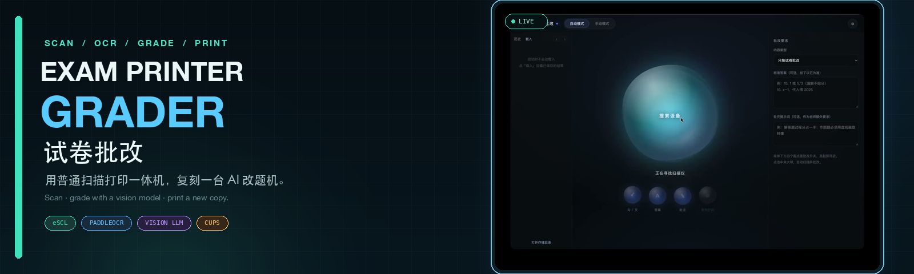

<p align="center">
  
</p>

<p align="center">
  <a href="https://github.com/zhj-ldm/exam-printer-grader/releases/latest"></a>
  
  
  
  
</p>

<p align="center">
  <a href="README.en.md">English</a> · <b>简体中文</b>
</p>

<p align="center">
  <b>把试卷放进扫描仪，点一下，出来的是一张已经批改并打印好的新卷子。</b><br>
  用普通扫描打印一体机，复刻一台属于自己的「AI 改题机」。
</p>

<details>
<summary><b>目录</b></summary>

- [这是什么](#这是什么)
- [为什么不一样](#为什么不一样)
- [演示](#演示)
- [主要功能](#主要功能)
- [工作流](#工作流)
- [快速开始](#快速开始)
- [使用步骤](#使用步骤)
- [配置说明](#配置说明)
- [技术结构](#技术结构)
- [数据与隐私](#数据与隐私)

</details>

## 这是什么

这是一个把**扫描、OCR 切题、视觉大模型批改、手写笔迹渲染和打印**串成一条流水线的桌面系统。

把做完的试卷或作业正面朝上放在打印机扫描仪上，点击界面中央的液态球，系统会自动：

```text
扫描 → 自动摆正 → 裁空白 → OCR 切题
     → 逐题交给视觉模型批改
     → 在对勾 / 叉 / 半对 / 批注位置生成手写笔迹
     → 重新打印一张批改后的新卷子
```

它不是一个“上传照片然后看看 AI 点评”的工具。**题目从扫描仪来，结果从打印机出**，整个流程深度绑定扫描打印一体机。

> **重要：打印出来的是重新打印的一张新作业。**<br>
> 相当于先把原作业复印一份，再在复印件上批改，而不是把原纸塞回打印机涂改。这是刻意设计：重新打印能适配不同纸张、装订和打印机，兼容性远好于二次进纸。

## 为什么不一样

| | 普通 AI 批改工具 | Exam Printer Grader |
| --- | --- | --- |
| 输入 | 手动拍照 / 上传 | 打印机扫描仪自动扫描 |
| 输出 | 屏幕查看 / 下载图片 | 直接打印一张新的纸质作业 |
| 硬件 | 与打印机无关 | 扫描、打印是流程的一部分 |
| 定位 | 图片处理工具 | 家用、低成本的改题机替代方案 |

## 演示

▶ **[播放完整演示视频](https://github.com/zhj-ldm/exam-printer-grader/releases/download/v1.0.0/exam-grader-demo.mp4)**

> 把作业放到扫描仪 → 点击按钮 → 自动扫描、批改 → 打印出批改后的新作业。

## 主要功能

- **一键全流程**：一个液态球按钮，自动完成扫描、切题、批改和出图。
- **多页扫描**：自动模式支持单页 / 多页；多页先逐页扫描，再统一批改，最后逐页查看和打印。
- **答案纸扫描**：标准答案框旁点「扫描答案」，扫一张答案纸自动整理成「题号. 答案」，也可以手动输入。
- **AI 复合检查（可选）**：出图前把成品图交回视觉模型复核，检查漏批与批注位置；复核次数默认 1 轮，最多 3 轮。
- **自动摆正**：0° / 90° / 180° / 270° 都能识别并纠正。
- **自动裁空白**：定位卷面内容区域，去掉扫描白边，打印时内容更大、更省纸。
- **逐题切块**：基于 OCR 题号定位；边界宁可多切，也不切掉题目最后一行。
- **手写笔迹**：对勾连贯且轻微抖动，半对叠加斜线，叉为两笔错位，支持批注文字。
- **可选项**：是否画对勾、是否写批注、是否标注正确答案、批改完是否自动打印。
- **成品模式**：批改结束只显示最终批改图，顶部按钮清空并开始下一张。
- **历史回看**：结果存本地，可回看、切换、单条删除；启动时列表为空但文件保留。
- **打印控制**：选择打印机、打印速度、彩色 / 黑白，设置持久化。
- **模型自由**：任何 OpenAI 兼容的视觉模型都可以，云端或本地（LM Studio / Ollama / vLLM），不绑定厂商。

## 工作流

```text
扫描仪 (eSCL)
   │  HTTP 取图
   ▼
自动摆正 (OCR 分数比对 0° / 90° / 180° / 270°)
   ▼
裁掉空白 (文字包围盒 / 暗像素分布)
   ▼
切题 (PaddleOCR 题号识别 → 题块坐标)
   ▼
逐题裁块 + 视觉模型判分 (OpenAI 兼容接口)
   ▼
落点计算 → SVG 手写笔迹 → sharp 合成
   ▼
CUPS (lp) 打印 / 写入本地历史
```

## 快速开始

### 运行环境

- macOS（当前 Release 为 Apple Silicon / arm64）
- 一台支持 **eSCL / AirScan** 的网络扫描仪（多数 AirPrint 一体机都支持）
- 打印机已在「系统设置 → 打印机与扫描仪」中可用

### 从源码运行

```bash
git clone https://github.com/zhj-ldm/exam-printer-grader.git
cd exam-printer-grader
npm install
npm start
```

### 打包 macOS 应用

```bash
npx @electron/packager . "试卷批改" --platform=darwin --arch=arm64 \
  --out=dist --asar=false --overwrite --prune=true
```

可选：删除不需要的平台原生库以减小体积。

```bash
rm -rf node_modules/onnxruntime-node/bin/napi-v6/{linux,win32}
```

## 使用步骤

1. 把作业**正面朝上**放在扫描仪玻璃板上（放反了也能自动纠正）。
2. 打开软件，点击中央的液态球。
3. 软件自动扫描、识别题号并逐题批改。
4. 完成后进入成品页，查看批改后的整页图。
5. 点「打印」输出新作业，或点「下一张」开始下一份。

## 配置说明

### 批改模型

- **来源**：云端（OpenAI 兼容）或本地（LM Studio / Ollama 等）
- **接口地址**：任意 OpenAI 兼容的 `/v1/chat/completions`
- **模型名**：任意具备图片理解能力的模型
- **API Keys**：多个 Key 用英文逗号分隔，会轮流使用；本地服务通常留空

程序只依赖标准 OpenAI 协议（`messages` + `image_url`），不读取任何厂商专属环境变量。接口地址留空时的示例值是 `https://api.openai.com/v1/chat/completions`，仅为格式示例。

### 逐空精确批改

适用于填空量大的卷子（如化学，一题 10–30 个空）。把「核批方式」切到 **精确批改（逐空判定，可多个对勾）**，再选择批改范围：

| 模式 | 做法 | 适合 |
| --- | --- | --- |
| 先切题再批改 | 按题号切块，模型返回每个空的答案、判定与边界框 | 标准试卷排版 |
| 模型框题 | 模型先框出完整题目区域，再逐块批改 | 一行并排两题、题号缺失、排版不规则 |
| 整页直读 | 整页交给视觉模型，由模型寻找所有空位并判定 | 分栏复杂、无题号页面 |

三种方式都只依赖视觉模型，不额外下载本地 OCR 模型；模型框题 / 整页直读失败时会回退到切题模式。

### 扫描仪

- 自动发现局域网内的 eSCL 扫描仪
- 可手动填写扫描仪 IP
- 显示状态、型号、扫描源和最高 dpi

### 打印

- 选择默认或指定打印机
- 快速（草稿）/ 标准 / 高质量
- 彩色 / 黑白
- 统一按普通纸输出，避免驱动把试卷当成照片而严重降速

### 存储与清理

- 显示当前存储目录与占用，可更换目录、打开目录
- 一键清理临时文件
- 启动时自动清理 24 小时前的临时扫描图

## 技术结构

```text
main.js              Electron 主进程：窗口、IPC、配置、存储、打印
preload.js           安全桥：contextBridge 白名单 API
cli.js               无界面命令行：切题 → 批改 → 出图
core/
  scan.js            eSCL 扫描发现 / 取图 + CUPS 打印
  ocr.js             PaddleOCR(ONNX) 识别、题号聚类、题块切分
  prepare.js         自动摆正 + 裁掉空白
  pipeline.js        主流水线：裁块、并发批改、落点、渲染
  grade.js           OpenAI 兼容批改接口、提示词、重试与限速
  render.js          SVG 手写笔迹引擎 + sharp 合成
ui/                  液态球界面、成品页、设置
```

无界面调试：

```bash
node cli.js --image /path/to/scan.jpg --out /tmp/graded.jpg
```

## 数据与隐私

- 扫描图、批改结果只存在本机。
- 只有在你配置云端接口时，题块图片才会发送到对应服务。
- API Key 保存在本机配置文件中，不随仓库分发。
- 仓库与发布包中不包含厂商品牌、密钥或用户数据。

## 已知限制

- 当前发布包为 macOS arm64；Windows / Linux 需要适配扫描与打印层。
- 扫描依赖 eSCL；仅支持厂商私有协议或纯 USB 的老扫描仪无法直接使用，可改用手动选图。
- 手写识别与主观题评分受底图清晰度与模型能力影响，复杂阅读题仍可能出现偏差。
- 打印为整页重新输出，不保留原纸装订、折痕等信息。

## 跨平台

- 批改 / OCR / 渲染为纯 Node + sharp，跨平台一致。
- 打印：macOS 使用 `lp`；Windows 可改为 `webContents.print()` 或 SumatraPDF；Linux 仍可用 `lp`。
- 扫描：网络 eSCL 三平台通用；USB 扫描仪需要在各平台接入原生扫描 API。

## License

[GNU General Public License v3.0](LICENSE)
